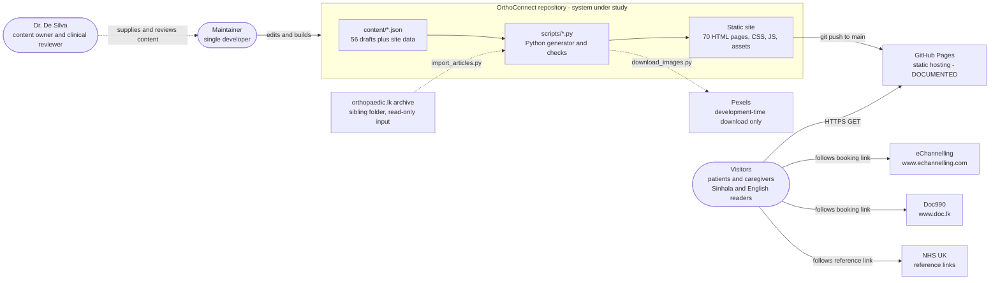
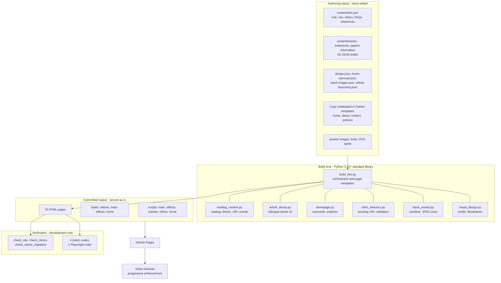
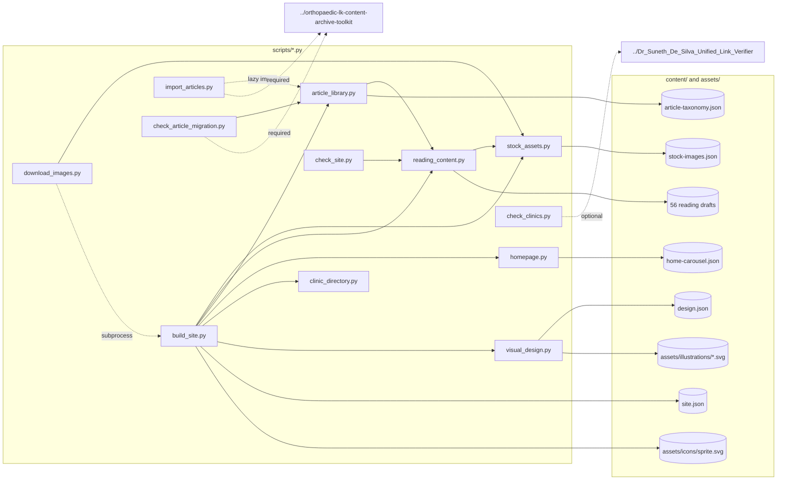
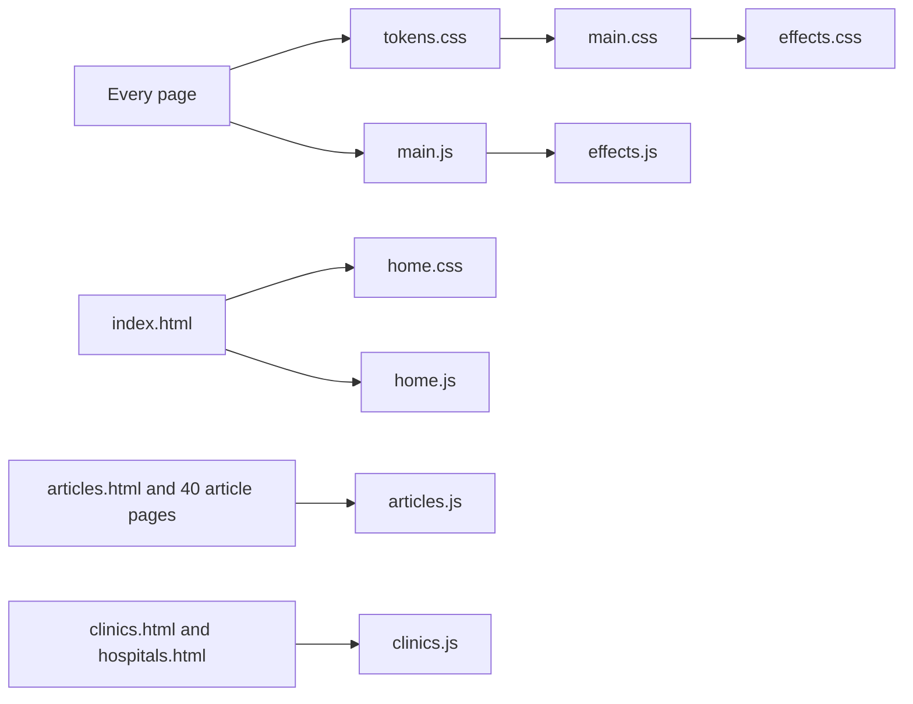

# 06 — System Architecture

Evidence legend: **CONFIRMED · INFERRED · DOCUMENTED · NOT IMPLEMENTED · UNKNOWN**.
This document describes the **actual** architecture. Nothing here is a proposal. Diagrams are Mermaid (render on GitHub or any Mermaid viewer).

## 1. Architectural pattern (CONFIRMED)

**Custom static-site generation (SSG) with committed output and progressive-enhancement client scripts.**

* **Not** a PHP application, **not** MVC, **not** client/server: there is no runtime server code.
* Content is **data** (JSON) plus a small amount of **copy embedded in Python templates**. A Python script renders every page to static HTML at build time. The HTML is **committed to git** and served unchanged.
* The browser receives complete documents. JavaScript only *enhances* (menus, filters, carousels, scroll-spy); every page is readable without it.
* Quality is enforced by **validators that run before any file is written** and by **post-build audit scripts**, not by a server or CI (no CI gate exists — see AW-01).

| Characteristic | Finding | Evidence |
|---|---|---|
| Rendering model | Build-time, single pass, deterministic (rebuild is byte-identical) | CONFIRMED (executed) |
| Templating | Python f-strings in `build_site.py` / helpers — no template engine | CONFIRMED |
| State | None server-side; filter state lives in the URL query string | CONFIRMED |
| Runtime network calls | None from site code (no `fetch`/XHR/WebSocket) | CONFIRMED |
| Routing | One file per route; relative URLs rewritten per directory depth | CONFIRMED |
| Trust model | Content JSON/Markdown is data: always HTML-escaped; no raw HTML accepted | CONFIRMED (`render_blocks`) |
| Deployment | Git push to `main` → GitHub Pages serves repo root | DOCUMENTED |

## 2. System context diagram

## 3. High-level component architecture

## 4. Detailed application architecture — module and data dependencies

Notes: solid arrows are imports/reads; dotted arrows are optional/lazy/subprocess or reach **outside the repository** (to sibling folders).

## 5. Runtime page → asset composition

(Chosen in `build_site.py:write_page()` L354-358 by the page's `active` key.)

## 6. Layers and their dependencies

| Layer | Contents | Depends on | Notes |
|---|---|---|---|
| **Presentation (client)** | HTML, CSS, vanilla JS | Local assets only | No external runtime dependency (CONFIRMED) |
| **Presentation templates (build)** | f-string templates in `build_site.py`, `homepage.py`, `article_library.py`, `visual_design.py` | Data layer | Markup and user-visible copy are mixed in code |
| **Application/business rules (build)** | Catalog validation, URL allow-listing, status/review rules, escaping, URL rewriting | Data layer | Run **before** writing |
| **Data** | JSON files + binary assets | — | No DB. Provenance JSON is also stored here |
| **Infrastructure** | git, GitHub Pages, optional Actions | — | Not configurable from the repo except `.nojekyll` and the workflow file |
| **Verification** | Python audits + Node suites | Output + sibling folders | Optional external deps (jsdom, Playwright) |

## 7. System boundaries and trust boundaries

| Boundary | Inside | Crossing | Control |
|---|---|---|---|
| **Repository** | sources, generator, output | Reads two **sibling folders** (clinic verifier report, article archive); README points to a third (stale copy) | Optional/ graceful for clinics; **required** for article audit/import |
| **Build machine** | Python run by the maintainer | Optional network call in `download_images.py` (HTTPS, size/type checks) | Staged download; no overwrite on failure |
| **Hosting** | GitHub Pages | Serves the whole repo root | **No allow-list** (S-01) |
| **Visitor browser** | HTML/CSS/JS | Outbound navigation to eChannelling, Doc990, NHS | `rel="external noreferrer"` / `noopener noreferrer` (CONFIRMED) |
| **Third-party booking providers** | Out of our control | Receive the visitor (and nothing else) | Build-time host/path allow-listing |
| **Legacy archive content** | 40 articles + 251 images | Treated as untrusted *data*: escaped, never executed | `render_blocks`, local-image check |

## 8. Architectural strengths (CONFIRMED)
1. **Zero runtime attack surface and zero runtime dependencies** — no server, DB, cookies, third-party JS.
2. **Deterministic, validated build**: failure occurs before any page is written; output is reproducible byte-for-byte.
3. **Defence in depth for content integrity**: three independent Python audits + 628 DOM assertions + hash-pinned assets and provenance.
4. **Progressive enhancement and file-protocol support**: pure relative URLs; works with JS disabled.
5. **Clear separation of data and logic for long-form content** (one JSON per page, documented block schema).
6. **Privacy-by-construction** (no state, no storage).

## 9. Architectural weaknesses and risks

| ID | Weakness | Evidence | Impact |
|---|---|---|---|
| **AW-01** | **No CI gate.** Output is committed; nothing automatically proves it matches the sources or passes the checks. The only workflow is a disabled Jekyll sample that would publish a *different* build. | `.github/workflows/jekyll-gh-pages.yml`; README | Stale/hand-edited HTML can reach production |
| **AW-02** | **Content split between JSON and Python.** Home/About/Contact/Policy copy, hero pills, featured article IDs and expertise cards live in `build_site.py`/`homepage.py`. | `build_site.py` L139-158, 165-168, 249-276 | Non-developers cannot edit core copy; facts duplicated in 4 places |
| **AW-03** | **Publish-everything model.** Repo root is the web root. | README §GitHub Pages | Internal docs/provenance exposed (S-01) |
| **AW-04** | **Portability:** two checkers and the importer require sibling folders at fixed relative paths; README hard-codes an absolute local path. | `check_clinics.py:13`, `import_articles.py:157`, `README.md:139` | Cannot run full verification from a fresh clone |
| **AW-05** | **Undeclared dev dependencies** (jsdom, Playwright, Chrome, Pillow). | no manifests | Tests not reproducible by a newcomer |
| **AW-06** | **Duplicate alias pages** instead of redirects/canonicals. | `build_site.py:392,399-400` | Duplicate content once indexing is enabled |
| **AW-07** | **`noindex` is a hard-coded constant** in the page skeleton, not a config switch. | `build_site.py:365` | Going live requires a code change + full regeneration |
| **AW-08** | **Relative-URL 404 page** — styles/scripts resolve relative to the *requested* path, so deep missing URLs render unstyled on Pages. | `404.html` head; hosting behaviour (INFERRED) | Cosmetic |
| **AW-09** | **Import-time global state** (`DATA`, `TAXONOMY`, `STOCK`, `DESIGN` loaded at module import). | `build_site.py:19-23`, others | Harder unit testing; acceptable at this scale |
| **AW-10** | **No cache-busting** for CSS/JS (`styles/main.css` unversioned). | page `<head>` | Browsers may serve stale assets after deploys (INFERRED) |
| **AW-11** | **Single language chrome** — header/footer/nav remain English on Sinhala pages. | `lang="en"` wrappers | UX gap for Sinhala readers |

## 10. What would change if the architecture changed (informational, not a proposal)
The brief and its (absent) technical-architecture spec hint at a possible WordPress/PHP direction. The content model is already cleanly separable (one JSON document per page with typed blocks; typed taxonomy; clinic records with provider sub-objects — see `09_DATABASE_ARCHITECTURE.md`), which would map to any CMS schema. **No migration work exists in the repository.** See `20_ARCHITECTURAL_DECISIONS_AND_OPEN_QUESTIONS.md`.
