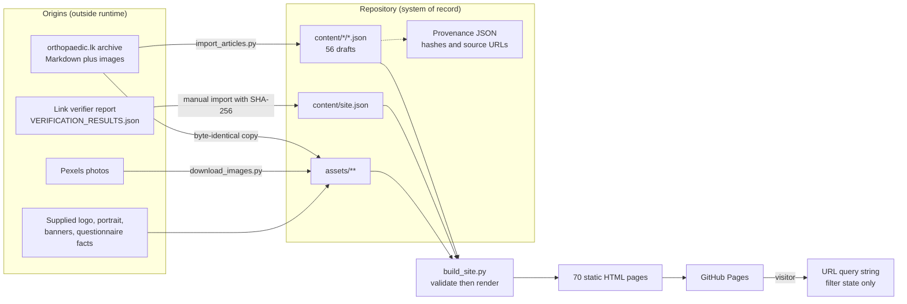
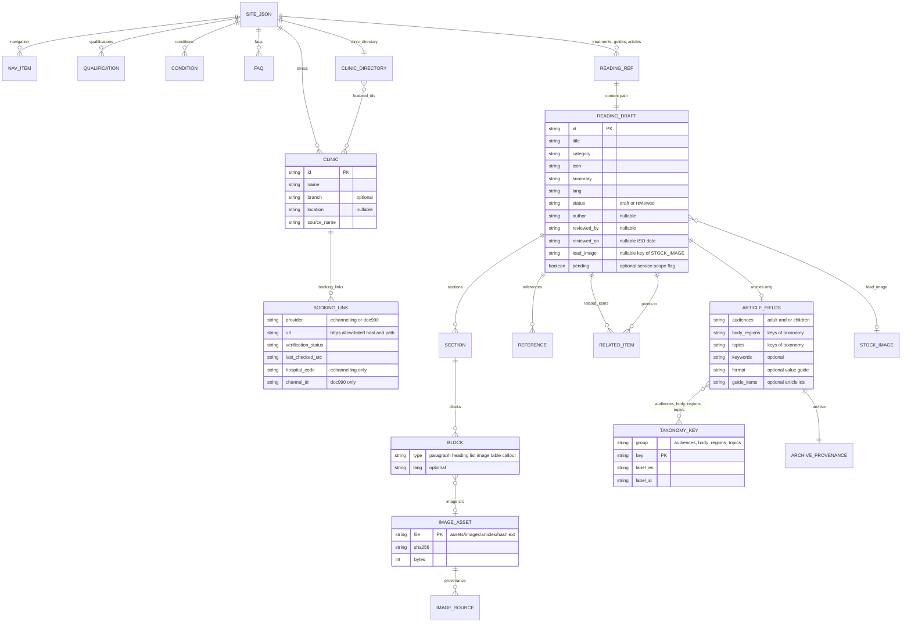

# 09 — Database and Data Architecture

Evidence legend: **CONFIRMED · INFERRED · DOCUMENTED · NOT IMPLEMENTED · UNKNOWN**.

> ## ⚠ There is no database
> **CONFIRMED.** No `.sql` file, schema, migration, DB driver, connection string, ORM or query exists in the repository. No MySQL/MariaDB (or any other) engine is referenced. The brief's "MySQL / MariaDB (if present)" is answered: **not present**.
>
> Per the investigation rules, no database architecture is invented here. What *does* exist is a **file-based content model** (JSON + binary assets) with strict build-time validation. §3 documents it, including an entity-relationship diagram that is **explicitly a model of JSON documents, not of database tables**.

## 1. Where data lives

| Store | Used? | Evidence / content |
|---|---|---|
| Relational/NoSQL database | **No** | — |
| PHP sessions | **No** (no PHP) | — |
| Cookies | **No** | no `document.cookie`; privacy page says none; verified |
| `localStorage` / `sessionStorage` / IndexedDB | **No** | grep over `scripts/*.js` → 0 |
| JSON files in the repo | **Yes — the system of record** | `content/**/*.json` (66 files) |
| Binary assets in the repo | **Yes** | `assets/**` (images, fonts, SVG) |
| Configuration files | Yes, as JSON | `design.json`, `home-carousel.json`, `stock-images.json` |
| Git history | Yes — the only audit trail | 8 commits |
| URL query string (browser state) | **Yes** (ephemeral) | `lang`, `audience`, `region`, `topic`, `q`, `library` (articles); `q`, `location`, `platform` (clinics) |
| External services | Booking data lives **only** at eChannelling / Doc990 / hospitals | OrthoConnect never receives it |

## 2. Data lifecycle

| Stage | Data handling |
|---|---|
| **Creation** | Maintainer edits JSON by hand, or runs the importer once (already done for the 40 articles). |
| **Validation** | Fail-fast checks before writing (`08_BACKEND_ARCHITECTURE.md` §4). |
| **Transformation** | Rendered to escaped HTML; relative-URL rewriting; derived search blobs placed in `data-search` attributes. |
| **Storage of output** | Committed HTML = denormalised copy of the content (e.g. the 40-card article index duplicates each summary and a `data-search` blob). |
| **Retrieval** | Browser fetches static files; JS filters the DOM; filter state serialised into the URL. |
| **Retention/deletion** | Git history retains everything, including 5 retired dummy articles' IDs (`retired_articles`) so the generator removes stale pages. No personal data is ever collected, so no personal-data lifecycle exists. |

## 3. File-based content model

### 3.1 Entity-relationship diagram (JSON document model — not SQL tables)

### 3.2 Document inventory and cardinalities (CONFIRMED by counting)

| Document | Cardinality | Notes |
|---|---|---|
| `site.json.navigation` | 8 | `{id,label,file}` |
| `site.json.qualifications` | 6 | `{title,institution,description,icon}` |
| `site.json.conditions` | 9 (5 `pending`) | `{id,title,category,icon,summary,pending?,body[],related,relatedLabel}` — **no `source`/`questions` keys used** |
| `site.json.treatments` / `guides` / `articles` | 8 / 8 / 40 | references only: `{id, content:"content/<folder>/<id>.json"}` |
| `site.json.faqs` | 6 | `{question,answer}` |
| `site.json.clinics` | 18 | 8 both providers, 5 eChannelling-only, 5 Doc990-only; 1 has `branch`; 2 have `location: null` |
| `site.json.clinic_directory` | 1 | `{doctor,source_file,source_toolkit,source_generated_at_utc,source_sha256,featured_ids[2]}` |
| `site.json.retired_articles` | 5 | slugs of removed dummy articles |
| Article drafts | 40 (19 en / 21 si) | 99 sections; blocks: 803 paragraph, 390 image, 15 heading, 8 list |
| Treatment drafts | 8 | 16 paragraph blocks total (2 sections × 1 paragraph each) |
| Guide drafts | 8 | 16 paragraph, 8 list, 1 table |
| Taxonomy | 2 audiences, 14 body regions, 13 topics | bilingual labels |
| `article-assets.json` | 251 assets | 369 distinct `(article, archive file, URL)` provenance records (390 image *blocks*; repeated use of one image in one article collapses to one record) |
| `article-image-descriptions.json` | 251 | keyed by SHA-256 → `{alt, lang}` |
| `article-migration.json` | 40 article records, 31 omission events | `3 placeholder + 26 legacy-enquiry-prompt + 1 gallery-formatting + 1 formatting-separator` |
| `stock-images.json` / `stock-assets.lock.json` | 5 photos / 10 files | |
| `home-carousel.json` | 4 slides | each with 2 responsive variants + 1 desktop 1920×700 |
| `design.json` | 7 page motifs, 3 illustrations | SHA-256 pinned |

### 3.3 Integrity constraints actually enforced (the "schema")

| Constraint | Where | Type |
|---|---|---|
| Primary-key-like uniqueness: reading IDs per kind, section & sub-heading IDs per page, clinic IDs, article IDs | `reading_content.py`, `clinic_directory.py`, `article_library.py` | build-time |
| Foreign-key-like: `related_items` → existing draft; `guide_items` → existing article; `featured_ids` ⊂ clinic IDs; `lead_image` → stock key (silently ignored if absent); taxonomy keys exist | same | build-time |
| Check-like: status enum, review date ≤ today, language pattern, HTTPS-only references, booking URL host/path/ID agreement | same | build-time |
| Referential file integrity: content path equals `content/<folder>/<id>.json`; images exist under `assets/images/`; illustration & stock hashes match | same + `check_site.py` | build/check-time |
| Source conservation: archive text/image stream equals imported text/image stream (modulo logged omissions) | `check_article_migration.py` | check-time (needs sibling archive) |

There are **no indexes, transactions, triggers or concurrency controls** — the repository is edited by one person and validated in a single process.

## 4. Provenance data (published with the site)

`content/article-migration.json`, `content/article-assets.json` and every article's `archive` block record **source URLs on the legacy `orthopaedic.lk` domain** (e.g. `https://orthopaedic.lk/hip-adults/`, image URLs under `/wp-content/uploads/2020/11/…`), file names, SHA-256 digests and extraction timestamps (`2026-10-24…`). The generator never emits these as links (BR-07), but the raw JSON files are **publicly downloadable** if the repository root is published (S-01).

## 5. Data quality observations

| ID | Observation | Evidence |
|---|---|---|
| DQ-01 | Inconsistent naming of the same chain: "Medihelp **Hospital**" (Athurugiriya, Homagama, Mount Lavinia) vs "Medihelp **Hospitals**" (Bandaragama, Piliyandala) | `site.json` clinics |
| DQ-02 | Locality embedded in name for one clinic (`Perlyn Hospital - Badulla`, `location: null`) while its neighbour `Central Hospital` + `location: "Badulla"` is split | `site.json` |
| DQ-03 | Two clinics have no locality (`mdk-hospital`, `perlyn-hospital-badulla`) — by policy ("do not infer") | `content/README.md` |
| DQ-04 | `branch` is used by one record only (`Kirimandala Mw`) | `site.json` |
| DQ-05 | `keywords` for all imported articles is a single archive note (e.g. "Adult hip"), so search relies on titles/summaries/taxonomy labels | `import_articles.py:199` |
| DQ-06 | Booking links were checked on **2026-10-25**; `last_checked_utc` is stored but never re-validated | `site.json` |
| DQ-07 | 265 paragraph blocks carry `question: true` (auto-detected by a heuristic in the importer: short, ends with "?" or starts with a wh-word) — a presentation hint inferred by regex, not by editors | `import_articles.py:146` |
| DQ-08 | The importer's heuristic summaries (`article-import-plan.json`) were authored once; articles' `summary` is editorial copy now | `content/README.md` |
| DQ-09 | `site.json` mixes presentation data, content, and provenance (clinic_directory) | structure |

## 6. If a database were introduced later (informational only)
The model above normalises cleanly: `reading_draft`, `section`, `block` (typed, ordered), `taxonomy_key` (+ many-to-many link table), `clinic`, `booking_link` (provider-specific columns), `image_asset` (+ sources), `faq`, `qualification`. That is a design observation, **not** an implementation plan.
