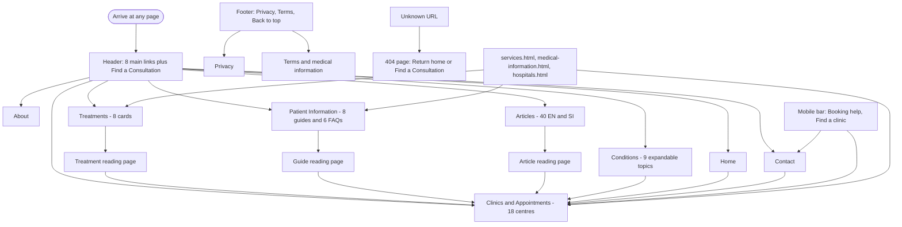
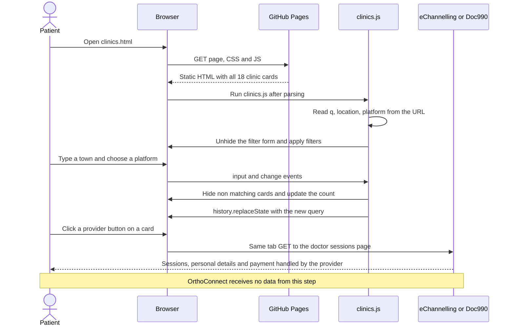
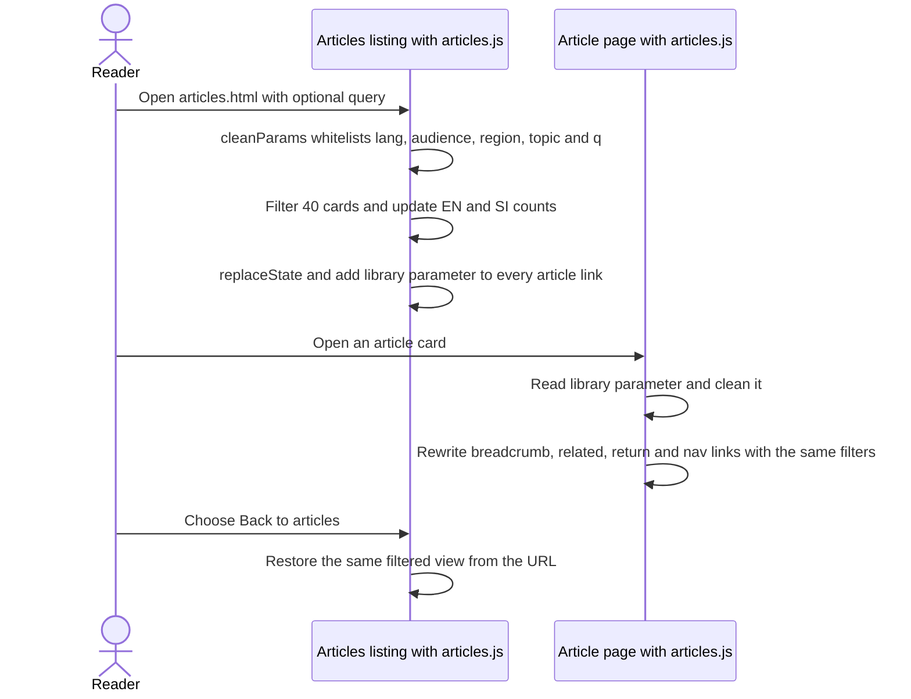
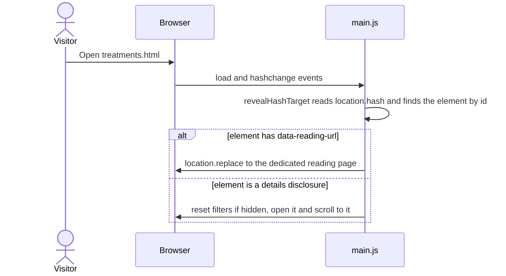
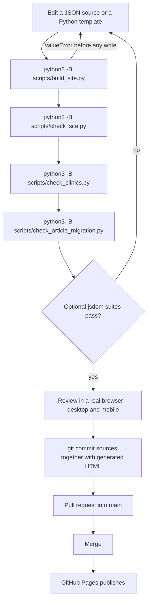
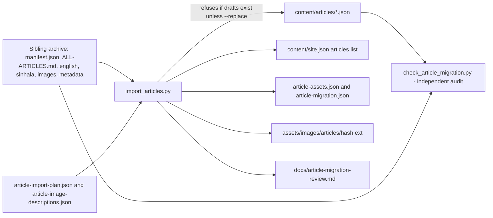
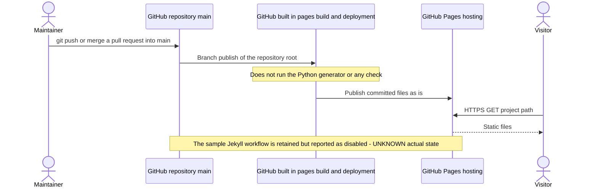
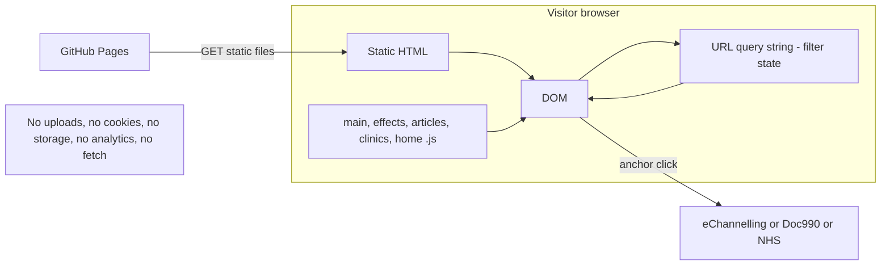

# 10 — Workflows and Data Flows

Evidence legend: **CONFIRMED · INFERRED · DOCUMENTED · NOT IMPLEMENTED · UNKNOWN**.
In every runtime workflow: **Backend = none (static file serving only)** and **Database = none**.

## 1. Workflow register

| ID | Workflow | Actor | Kind | Status |
|---|---|---|---|---|
| W-01 | Site navigation | Visitor | runtime | **Implemented** (CONFIRMED) |
| W-02 | Find a clinic and follow a booking link | Visitor | runtime | **Implemented**; booking itself is external |
| W-03 | Discover and read articles (filters ↔ reading page ↔ return) | Reader | runtime | **Implemented** |
| W-04 | Search/filter Conditions, Treatments, Patient Information | Visitor | runtime | **Implemented** |
| W-05 | Get booking help / prepare / emergency guidance | Visitor | runtime | **Implemented** |
| W-06 | Legacy bookmark forwarding (`page.html#topic`) | Visitor | runtime | **Implemented** |
| W-07 | Edit content and rebuild | Maintainer | build | **Implemented** |
| W-08 | Import the legacy article archive | Maintainer | build (one-off) | **Implemented**, already executed |
| W-09 | Publish to GitHub Pages | Maintainer | deploy | DOCUMENTED (not verified live) |
| W-10 | Refresh stock photographs | Maintainer | build | **Implemented** (`--check` verified; download path not run) |
| W-X1 | Telephone call / WhatsApp chat / e-mail the clinic | Visitor | runtime | **NOT IMPLEMENTED** |
| W-X2 | Map/directions to a clinic | Visitor | runtime | **NOT IMPLEMENTED** |
| W-X3 | On-site appointment request / enquiry form | Visitor | runtime | **NOT IMPLEMENTED** (removed prototype demo) |
| W-X4 | Admin login, content management, user management | Staff | runtime | **NOT IMPLEMENTED** (excluded) |

## 2. W-01 Site navigation

* **Frontend:** `main.js` toggles the menu (`aria-expanded`, `inert`), closes on Esc/outside/focus-out/link click; active item gets `aria-current` (`page` on top-level pages, `location` on nested reading pages).
* **Validation:** `check_site.py` asserts the same 8 links, in the same order, with the right active state on all 70 pages.
* **Alt path (no JavaScript):** CONFIRMED in CSS — `.menu-toggle { display: none }` (`main.css:69`) is only shown under `.js-enabled` (`main.css:375`), and the collapsing dropdown rules (`main.css:377-380`, `effects.css:76-77`) are likewise scoped to `.js-enabled`. Without JS the nav therefore remains a visible, wrapping link list at every width (`main.css:376`). `main.js` adds the `js-enabled` class as its first statement.

## 3. W-02 Find a clinic and follow a booking link

**Start:** `clinics.html` (or Home / Contact featured cards, or any "Find a Consultation" CTA).
**Frontend:** all 18 cards are in the HTML; `clinics.js` un-hides the filter form, applies URL state, updates counts, shows an empty state with a clear-filters button.
**Backend/DB:** none. **External:** the click leaves the site.
**Validation:** build-time URL allow-listing (`clinic_directory.py`); `check_clinics.py` asserts equality with the verifier report and that every link is `https`, same-tab and has a descriptive `aria-label`.
**Outcome:** visitor lands on the provider's doctor-and-hospital sessions page. **Alt paths:** no JS → full list, no filters; no match → "No matching clinics" + clear; provider page unavailable → outside our control (**UNKNOWN** link health since 2026-10-25).

## 4. W-03 Discover and read articles

**Start:** `articles.html[?lang=…&audience=…&region=…&topic=…&q=…]`.
**Frontend (`articles.js`):** `cleanParams()` whitelists each parameter (`lang` ∈ en/si; `audience` ∈ adult/children; `region`/`topic` slug regex; `q` trimmed to 160); `update()` filters the 40 cards on `data-language/audiences/regions/topics/search`, writes counts as text nodes, `replaceState`s the URL, and copies the current query into a `library` parameter on every `[data-article-link]`. On a reading page the same script reads `library`, then points breadcrumb, related-article links, return link and the "Articles" nav item back to the same filtered view. Without `library`, a Sinhala page returns to the Sinhala collection.
**Validation:** `validate_articles()` at build; `check_articles_dom.cjs` (42 assertions).
**Alt paths:** invalid parameters → treated as "all"; `file://` History restrictions → `try/catch`, filters still work; no JS → all 40 cards visible, links work.

## 5. W-04 Search/filter listings (Conditions, Treatments, Patient Information)
`main.js` L45-84: for each `[data-filter-scope]`, `updateFilters()` normalises (NFKD, strip diacritics, lower-case) the query, tests `data-search` and `data-category`, toggles `hidden`, updates the polite live count ("N topics") and the empty state; reset restores. State is **not** in the URL for these three pages (unlike Articles and Clinics). **Alt paths:** no JS → all cards visible; `#topic` fragments open the matching `
` (conditions) or forward to the reading page (W-06).

## 6. W-05 Contact / booking help
`contact.html` presents three cards (Book → clinics; Change an appointment → use the confirmation details of the hospital/provider; Prepare → consultation guide), two featured clinic cards, and an emergency note. **No** telephone, e-mail, WhatsApp, map or form exists (CONFIRMED). The mobile bar's "Booking help" targets this page.

## 7. W-06 Legacy bookmark forwarding

Generated links never use fragments for reading pages — `resolve_content_url()` rewrites them at build time. The runtime path exists only for external/legacy bookmarks. Safe by construction: the redirect target is read from a build-time `data-*` attribute of the matched element, never from the URL itself.

## 8. W-07 Edit content and rebuild (maintainer)

Rules: never edit generated HTML; keep `id`s stable; keep `status: "draft"` until a named reviewer and date exist; unknown facts stay `null`/omitted; rebuild changes ≥1 generated file when sources change. (`content/README.md`, `README.md`.)

## 9. W-08 Legacy archive import (already executed; guarded)

Cross-checks inventories (40 manifest rows = 40 plan rows = 40 `**Article ID:**` lines), requires an approved description for every image hash, copies each distinct image once (SHA-256 filename), validates all drafts **before** writing anything. **Hazard:** `--replace` overwrites editorial changes.

## 10. W-09 Publish (DOCUMENTED)

## 11. End-to-end data flow (runtime)

Personal data collected by OrthoConnect: **none** (CONFIRMED). The hosting service may log standard request metadata (stated in `privacy.html`).

## 12. Workflows described but not implemented
| Source | Workflow | Evidence of absence |
|---|---|---|
| Brief §6 | Telephone links; WhatsApp integration; Maps and directions | 0 `tel:`/`wa.me`/map URLs in 70 pages; unused `phone`/`mail` icons only |
| Brief §6 | Consultation schedules; appointment-related actions on site | No schedule data; `README.md` explicitly rejects fabricated schedules; actions delegated to providers |
| Brief §6 Administrative | Authentication, user/role management, dashboard, CRUD, uploads, settings, sessions | no code; `README.md`: staff CMS demo excluded |
| Prototype (`v4-OrthoConnect-Prototype-v2`, not in repo) | Booking dialogs, enquiry preview, `admin.html`, CMS-created `page.html` | Removed/excluded; `check_clinics.py` forbids their markup |
