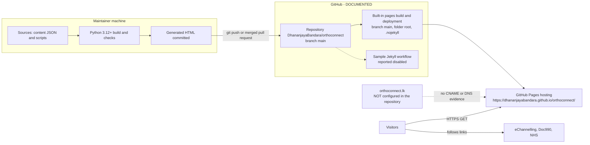

# 17 — Deployment and Environment

Evidence legend: **CONFIRMED · INFERRED · DOCUMENTED · NOT IMPLEMENTED · UNKNOWN**.
Nothing was deployed or changed during this investigation, and the live site was **not contacted**.

## 1. How the system runs

| Mode | How | Status |
|---|---|---|
| **Direct file open** | Open `index.html` in a browser (`file://`) — all URLs are relative, fonts/images local | CONFIRMED (no root-relative URLs; DOM suites include `file://` cases) |
| **Local HTTP preview** | `python3 -m http.server 8080 --bind 127.0.0.1` from the repo root | **CONFIRMED** — executed in a scratch copy: `/`, `articles.html?…`, nested article, CSS and TTF returned 200; a missing file returned 404 |
| **GitHub Pages** | Push/merge to `main` → Pages serves the repo root | DOCUMENTED — `README.md` §GitHub Pages; **not verified live** |
| **Custom domain `orthoconnect.lk`** | — | **NOT IMPLEMENTED in the repo** (no `CNAME`, no references) |

There is **no application server, process manager, reverse proxy, runtime, environment file or database** to operate.

## 2. Software requirements

| Purpose | Requirement | Evidence |
|---|---|---|
| View the site | Any current evergreen browser | `04_TECH_STACK.md` §4 |
| Rebuild pages / run Python audits | **Python ≥ 3.12**, standard library only (author uses 3.14.4) | f-string syntax at `build_site.py:53`; README |
| Optional DOM suites | Node.js (v22 used here) + an installed **jsdom** (26.1.0 used here) | `scripts/check_*_dom.cjs` |
| Optional real-browser suite | Node + **Playwright** + Google Chrome | `check_homepage.browser.cjs` |
| Stock-image restore | Python + Internet access | `download_images.py` |
| Full verification (two audits + importer) | Sibling folders at fixed relative paths: `../Dr_Suneth_De_Silva_Unified_Link_Verifier/` (optional) and `../orthopaedic-lk-content-archive-toolkit/` (required) | `check_clinics.py:13`, `check_article_migration.py:139`, `import_articles.py:157` |
| Hosting | GitHub account with Pages enabled | DOCUMENTED |
| One-off asset prep (not in repo) | Pillow (WebP resizing), librsvg (SVG inspection) | `ASSET-SOURCES.md`, `docs/visual-design-validation.md` |

OS/locale: Linux assumed in docs and sandbox notes; paths use POSIX semantics (`posixpath`); Windows is UNKNOWN.

## 3. Environment variables (all optional, development only)

| Variable | Used by | Meaning | Default |
|---|---|---|---|
| `ORTHOCONNECT_JSDOM_MODULE` | clinics / effects / banners DOM suites | Absolute path to an installed `jsdom` | `require('jsdom')` |
| `ARTICLE_JSDOM_MODULE` | articles DOM suite | same | `require('jsdom')` |
| `ORTHOCONNECT_PLAYWRIGHT_MODULE` | browser suite | Path to Playwright | `require('playwright')` |
| `ORTHOCONNECT_PREVIEW_URL` | browser suite | Base URL of a served copy | `http://127.0.0.1:8765/` |
| `ORTHOCONNECT_SCREENSHOT_DIR` | browser suite | If set, writes screenshots | none |
| `ORTHOCONNECT_BROWSER_CHANNEL` | browser suite | Playwright browser channel | `chrome` |

**The shipped website reads no environment variables, secrets, or configuration files at runtime.** Build-time configuration is the JSON under `content/` (see `09_…`). No API keys or credentials exist anywhere (`12_…` §6).

## 4. Server / hosting configuration

| Aspect | Finding | Evidence |
|---|---|---|
| Web server config (`.htaccess`, nginx, headers) | **None**; not applicable on GitHub Pages | file inventory |
| PHP configuration / extensions | n/a | — |
| Publish source | `main` branch, `/ (root)` folder, **Deploy from a branch** | DOCUMENTED |
| Jekyll | Disabled by root `.nojekyll` (1 byte) | CONFIRMED (file) |
| HTTPS | "HTTPS enforced" | DOCUMENTED |
| Custom domain | No `CNAME` file in the repo root ⇒ no custom domain is configured for branch publishing as of HEAD | INFERRED (a UI-configured custom domain normally commits a `CNAME` file) |
| Redirects / rewrites | None possible; aliases are file copies | CONFIRMED |
| Error page | `404.html` (relative URLs) | CONFIRMED |
| Response headers / CSP | Not controllable from the repo | INFERRED (platform) |
| File permissions | Not applicable (static files; repo tracks mode bits only) | — |
| Project path support | All URLs relative ⇒ works under `/orthoconnect/` and at a domain root | CONFIRMED |

## 5. CI/CD workflow (`.github/workflows/jekyll-gh-pages.yml`)

| Aspect | Detail |
|---|---|
| Name | "Deploy Jekyll with GitHub Pages dependencies preinstalled" (GitHub's starter template) |
| Triggers | `push` to `main`; `workflow_dispatch` |
| Permissions | `contents: read`, `pages: write`, `id-token: write` |
| Concurrency | group `pages`, `cancel-in-progress: false` |
| Jobs | `build`: checkout (`@v4`) → `configure-pages@v5` → **`jekyll-build-pages@v1` (`source: ./`, `destination: ./_site`)** → `upload-pages-artifact@v3`; `deploy`: `deploy-pages@v5` in environment `github-pages` |
| What it would do | Build the root with Jekyll and deploy `_site` — **a different pipeline** from branch publishing, and it neither runs the generator nor the checks |
| Documented state | "retained in the repository and **disabled in Actions** to avoid competing deployments" (README) — **UNKNOWN** (GitHub-side setting) |
| Risk | See S-05 / G-O03 |

There is **no workflow that builds the site or runs any check** (G-T01).

## 6. Deployment procedure (DOCUMENTED, with verification status of each step)

1. Edit sources (`content/**/*.json`, templates in `scripts/*.py`, CSS/JS) — never the generated HTML.
2. `python3 -B scripts/build_site.py` — **verified**.
3. `python3 -B scripts/check_site.py`, `check_clinics.py`, `check_article_migration.py` — **verified** (the last needs the sibling archive).
4. Optional: jsdom suites / browser suite — **verified (jsdom)**, browser **not run**.
5. Commit **sources + regenerated HTML together**; open a PR; merge into `main` — process **DOCUMENTED** (two PRs exist in history).
6. GitHub's built-in "pages build and deployment" publishes the committed files — **not verified**.
7. **Rollback:** revert the commit on `main`, rebuild, check, push (DOCUMENTED).

## 7. Deployment architecture (as documented/verified)

## 8. What is deployed (publish boundary)
Everything tracked at the repo root (470 files, ≈44 MB): 70 pages, assets, **and** `content/`, `scripts/`, `docs/`, `README.md`, `ASSET-SOURCES.md`, `.github/` (see S-01). About 12.3 MiB of the ≈44 MB (≈28 %) is never rendered by a modern browser — the four banner PNG originals (7.06 MiB, only `` fallbacks inside `<picture>`) and the eight historical preview screenshots (5.22 MiB, referenced only from docs).

## 9. Production-launch readiness checklist

| Area | State | Blocking? |
|---|---|---|
| Build reproducible; audits pass | ✅ **Verified** | — |
| Hosting working | ⚠ Documented, **unverified** | — |
| Clinical review of 56 drafts | ❌ 0 reviewed | **Yes** |
| Rights to reuse legacy articles/images | ❌ Unresolved (X-02) | **Yes** |
| Service-scope confirmations | ❌ 8 items pending | **Yes** |
| `noindex` removal (deliberate code change + rebuild) | ❌ intentional | **Yes** at launch |
| Domain `orthoconnect.lk`: DNS, CNAME, TLS, canonical/absolute URLs | ❌ absent | **Yes** |
| `robots.txt`, `sitemap.xml`, canonical, OG/JSON-LD | ❌ | Recommended |
| Public contact details / WhatsApp / maps | ❌ not supplied | Client decision |
| Privacy/Terms legal review | ❌ not recorded | **Yes** (client/legal) |
| Real-browser & device pass (incl. Sinhala) | ❌ stale (25 Oct, pre-redesign) | Recommended |
| Accessibility audit; carousel pause decision | ❌ | Recommended |
| Font/image optimisation | ❌ | Recommended |
| CI gate; branch protection; CODEOWNERS | ❌ / UNKNOWN | Recommended (security) |
| Publish boundary (exclude internal docs/scripts) | ❌ | Recommended |
| Booking-link re-verification & monitoring | ❌ (last 2026-10-25) | Recommended |
| Rollback | ✅ git revert + rebuild | — |

**Verdict:** the site is technically deployable (and, per README, already deployed as a **noindex draft preview**). It is **not production-launch ready** — the blockers are content, rights, domain and legal, not code.

## 10. Items that could not be verified
Live availability and behaviour of the Pages site; Pages settings (source, HTTPS enforcement, custom domain, whether the sample workflow is disabled); DNS/registrar for `orthoconnect.lk`; HTTP caching headers; real-browser rendering; booking-link health; whether `.github/` is exposed; any WordPress/PHP system the brief alludes to.
