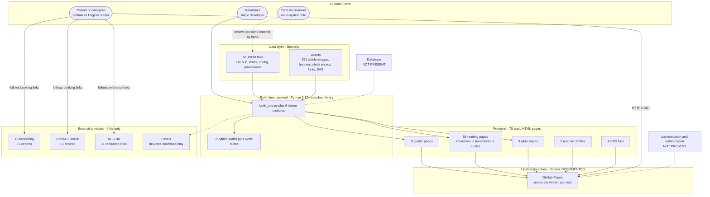
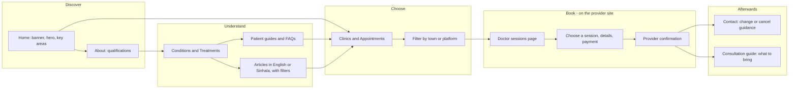

# 21 — Visual System Map

Evidence legend: **CONFIRMED · INFERRED · DOCUMENTED · NOT IMPLEMENTED · UNKNOWN**.
All diagrams describe the **actual** implementation (or are labelled DOCUMENTED / NOT PRESENT). None depicts a future architecture. The detailed diagrams live next to the text that explains them; this page holds the **master map**, the **consolidated user journey**, and an **index**.

## 1. Master system map

Reading the map: data flows left-to-right through the **build**, not through a server. At run time the only arrows are *visitor ↔ static host* and *visitor → external provider*. Authentication and database boxes are drawn only to show their **absence**.

## 2. Consolidated user journey

Not drawn because **NOT IMPLEMENTED**: telephone, WhatsApp, e-mail, map/directions, on-site appointment request, account login.

## 3. Diagram index

| # | Diagram | Type | Location |
|---|---|---|---|
| D1 | System context | flowchart | `06_SYSTEM_ARCHITECTURE.md` §2 |
| D2 | High-level component architecture | flowchart | `06_…` §3 |
| D3 | Detailed module and data dependencies | flowchart | `06_…` §4 |
| D4 | Runtime page → asset composition | flowchart | `06_…` §5 |
| D5 | Content model (JSON, not a database) | ER diagram | `09_DATABASE_ARCHITECTURE.md` §3.1 |
| D6 | Data lifecycle and provenance | flowchart | `09_…` §2 |
| D7 | Site navigation | flowchart | `10_WORKFLOWS_AND_DATA_FLOWS.md` §2 |
| D8 | Find a clinic and follow a booking link | sequence | `10_…` §3 |
| D9 | Discover and read articles | sequence | `10_…` §4 |
| D10 | Legacy bookmark forwarding | sequence | `10_…` §7 |
| D11 | Edit content and rebuild | flowchart | `10_…` §8 |
| D12 | Legacy archive import | flowchart | `10_…` §9 |
| D13 | Publish to GitHub Pages | sequence | `10_…` §10 |
| D14 | Runtime data flow | flowchart | `10_…` §11 |
| D15 | Deployment architecture | flowchart | `17_DEPLOYMENT_AND_ENVIRONMENT.md` §7 |
| D16 | Master system map | flowchart | this page §1 |
| D17 | Consolidated user journey | flowchart | this page §2 |

## 4. Rendering note
Diagrams are Mermaid fenced blocks, valid for GitHub's renderer and common Mermaid viewers. They were written by hand and **were not rendered in this environment** (no Mermaid renderer available); if one fails to render, the surrounding tables carry the same information in text.
